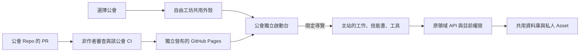

# 各公會的獨立啟動台

公會擁有自己的 UI repository、建置、CI 與 GitHub Pages 發布；會員登入、資料與實際業務操作仍由中央平台提供。這次依 2026-11-08 正式站公開 `/api/v1/guild-categories` 與各公會公開 launchpad 盤點，涵蓋 18 個內建與 8 個有效自訂公會。分類 pending 不等於公會未核准，沒有把它們排除。

`registry.json` 是主站核准的可執行來源綁定，`profiles/` 是這次移出的起始內容，`template/` 是可獨立建置的初始程式。各公會日後在自己的 Repo 改 `workspace.json`、`src/`，不必同步改中央 profiles，也不必部署主站；中央檔案只在新增來源或改 bridge 契約時更新。這不是另一套應用、安裝、會員或私人工作目錄。



## 使用者路徑

公會目錄的「進入工作區／啟動台」進入 `#guilds/<key>/start`。啟動台以公會的實際工作描述流程，連到 `work`、`skills`、`tools`、`information`。訪客選工作會進入原登入流程；入會與安裝仍由本人在主站確認。舊的 `#guilds/<key>` 深連結保持原本的工作或公開資訊入口。原已發布配置、公告、技能書綁定與會長編輯器繼續由原權威讀取。

公會啟動台是「工作」選單中的一個工作區，與原工作表單分開。切換只改顯示項，原 Reading 與工作表單保持 mounted，沿用草稿及未知提交保護。載入失敗有重試和原生工作／資源捷徑；沒有加入新公會權限、租戶資料搬遷或額外登入。

## 程式與權限邊界

主站只從受審 registry 產生 `https://freetwai.github.io/<repo>/`，不接受自填 slug、URL 或 draft 選擇程式。iframe 使用 `sandbox="allow-scripts"`，不允許 same-origin、表單、彈窗、下載或頂層跳轉。CSP 只在 Portal 文件允許該 frame origin；script-src、connect-src 和管理頁不放寬。這是隔離文件，沒有在主站 import 遠端 JavaScript。

`freedom.guild-launchpad/v1` 只包含四種本地導覽、ready 和有界 resize。主站驗 iframe contentWindow、opaque origin、每次 mount 的 channel、公會與嚴格欄位；子頁驗 parent window、主站 origin、版本、公會、channel 與有限動作。只向子頁提供主題、公開公會代碼與可用導覽，不傳 member ID、會員等級、session、CSRF、private DTO、草稿或任何命令。公會 Repo 的程式不能透過 bridge 提交入會、安裝、工作寫入或任意網址。登入、API 與 CSRF 保持 same-origin。

既有 `guild-presentation` 靜態編譯區塊仍處理需要私人資料的工具。新增資料操作或替換領域工具要在中央原領域審查；獨立公會畫面與導覽不再觸發中央全庫部署。公會 Repo 的全部畫面程式可以自行更新，受本 Repo 的審查與發布保護；中央不提供任意私有 API 代理。

Sandbox 的 opaque-origin 行為依 [MDN iframe 文件](https://developer.mozilla.org/en-US/docs/Web/HTML/Reference/Elements/iframe)；實際隔離、拒絕訊息與登入接續由本機瀏覽器測試驗證。

## 建立與維護 Repo

從中央 repo 執行：

```sh
node scripts/guild-repositories/scaffold.mjs guild_music_mv --out /absolute/new/directory
node scripts/guild-repositories/provision.mjs
```

第二個命令預設只列計畫。已有部署授權的 release maintainer 可以在來源已 commit、已完成驗證後，以 `--apply --out /absolute/fleet-directory` 建立全批，或加 `--guild <key>` 指定一個。它不覆寫既有 repo、不 force push、不修改現有中央保護；任何中斷保留逐倉收據，先讀回該階段再接續，不能盲目重建。初次 bootstrap 建立來源與 CI 後裝 main 保護；日後一律 PR、非作者 CODEOWNER 核准、最後 push 核准與 `verify` 通過。

各 repo 使用 Node 24、固定 Playwright lockfile、固定 action SHA。PR 只拿 contents:read；合併 main 後，成功 verify 產出同 run 的 Pages artifact，獨立 deploy job 才拿 pages:write／id-token:write。`github-pages` 環境限定 main，沒有 Cloudflare、資料庫或跨 repo 發布秘密。[GitHub 官方 Pages workflow 說明](https://docs.github.com/en/pages/getting-started-with-github-pages/using-custom-workflows-with-github-pages)描述這個發布能力。

手動發布／回復僅接受 main 歷史的完整 SHA，重新跑該倉驗證與發布；`release.json` 提供 source SHA／公會／repository／bridge 版本。失敗保留上次 Pages 內容，不把建置成功當成上線。核對 Actions、Pages environment 與公開 release.json 後才記錄成功。發布不取消執行中的同倉發布，各公會彼此不佔中央 shared-release queue。

新成立公會先使用既有原生啟動台。納入獨立發布時，維護者依目前公開公會 key 增加 profile／registry，沿相同 scaffold 與保護安裝；一般會員無須操作 GitHub。公會職稱不自動授予 GitHub 寫入權；各倉實際維護者可由現有 owner 依既有治理授權。

## 驗證與交付證據

中央 `guild-repository.test.ts` 驗拒絕訊息、來源清單與路由；`guild-repository.spec.ts` 使用真 sandbox、合成資料、三主題手機／桌面，驗本地導覽、登入、故障備援與資料隔離。各倉 `npm test` 驗配置與 HTML escaping；`npm run build` 後 `npm run test:browser` 驗三主題與尺寸。這些是 source-bound 本機測試，不等於正式會員使用或 26 倉都已發布；實際 repo、commit、CI、Pages 及公開讀回另外留收據。
